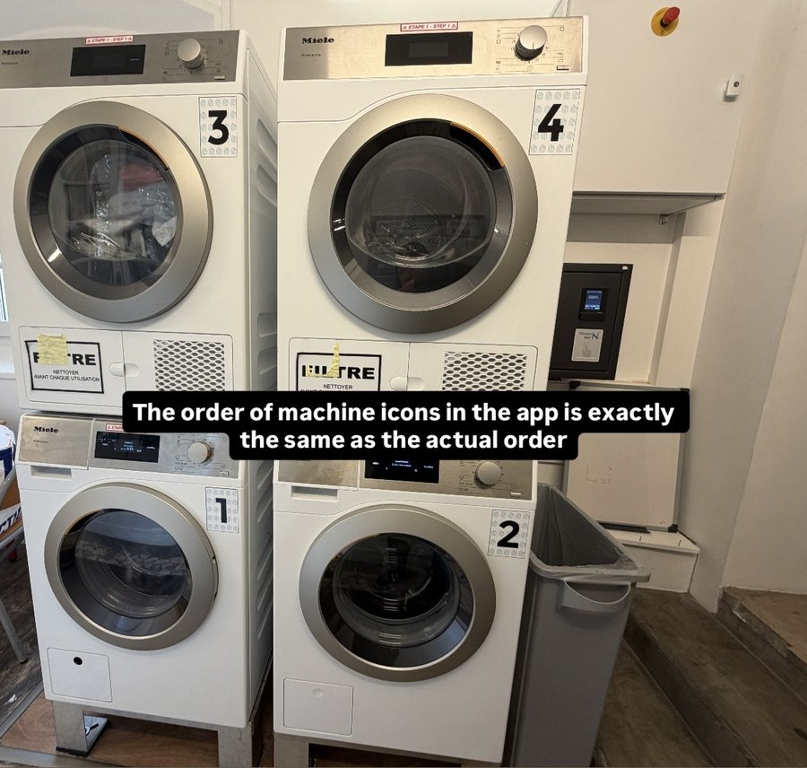
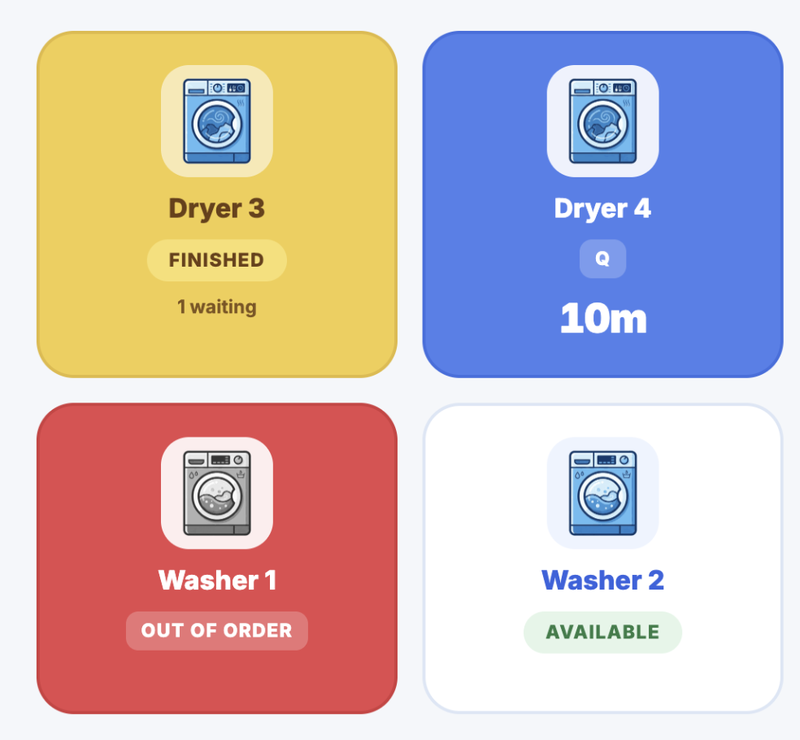
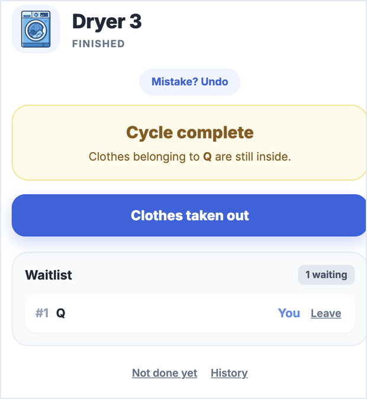
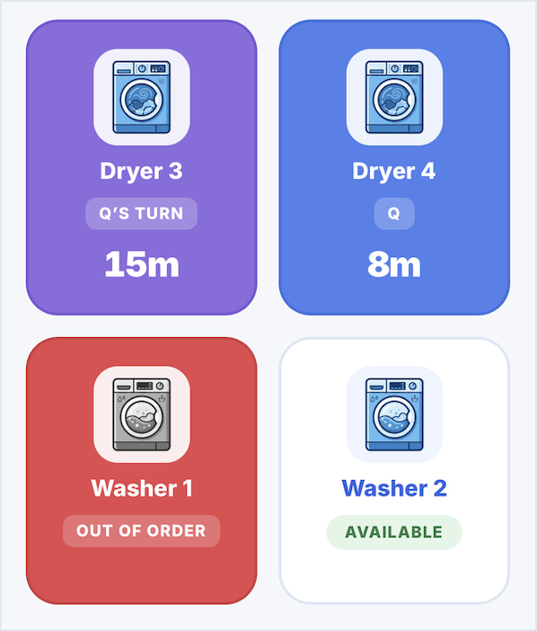
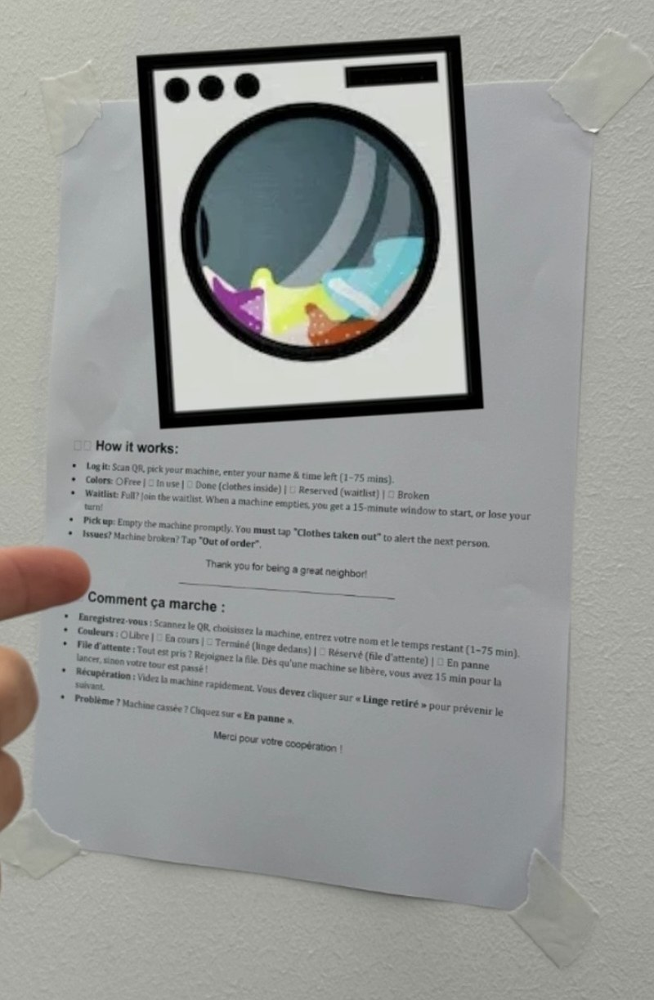
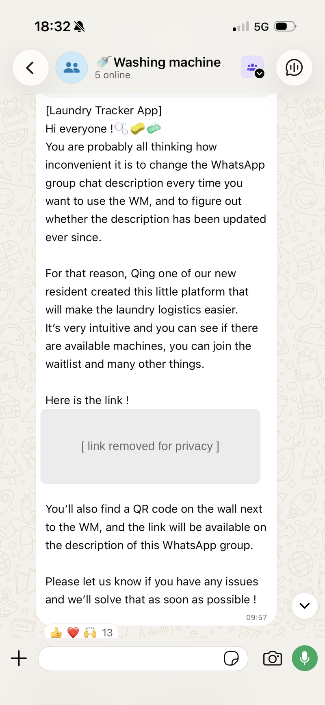

# Laundry Tracker for a Student Residence

A mobile-friendly web app that helps residents coordinate shared washing machines and dryers through manually updated machine status and per-machine waitlists.

**A real-world product project: identifying a problem, building with AI assistance, introducing it to residents, and maintaining it through feedback.**

## How it started

On a busy Sunday morning, I found an empty washing machine and loaded my clothes. A few minutes later, someone posted in our residence’s WhatsApp group: who had used the machine she was waiting for?

The machine looked available, but the coordination system told a different story.

Around 60–70 residents share two washing machines and two dryers. We had been tracking usage by editing the WhatsApp group description—a process that was easy to overlook and did not always reflect what was happening in the laundry room.

That morning, I used AI coding assistance to build an initial version of Laundry Tracker. Getting it into use, and adapting it to how people actually do laundry, became an ongoing project.

## My role and AI’s role

I initiated the project and took responsibility for the product work:

- Identifying the problem from firsthand experience.
- Defining the user flows and machine-status rules.
- Incorporating suggestions from a residence committee member.
- Refining the interface, wording, and English/French experience.
- Testing behavior and coordinating the rollout with the residence committee.
- Collecting feedback and directing changes after launch.

**Most of the code was generated by Claude.** I used AI assistance to translate requirements into an implementation, check its behavior, and revise it as new problems emerged.

The app runs on **Google Apps Script**. This project documents my product decisions, rollout, and ongoing maintenance, with the AI-assisted implementation available for inspection.

## Designing around the laundry room

Residents can open the app from a QR code beside the machines or a link in the WhatsApp group.

The interface mirrors the physical room: dryers 3 and 4 above washers 1 and 2. This makes it easier to connect an on-screen status with the machine in front of you.

<div align="center">

&nbsp;

<br>
<sub>The physical layout and the corresponding interface.</sub>
</div>

Residents can:

- Record a machine’s use and estimated time remaining.
- Distinguish an available machine from one whose cycle has finished but still contains clothes.
- Join or leave a waitlist for a specific machine.
- See a 15-minute reserved window when their turn arrives.
- Correct the remaining time or mark a machine out of order.
- Switch between English and French.

Machine status depends on residents’ updates; the app is not connected to the machines themselves.

## Product decisions shaped by real use

### 1. “Finished” does not mean “available”

A countdown can reach zero while someone’s clothes are still inside.

The app keeps these states separate. The next person’s 15-minute window begins when someone confirms that the clothes have been removed, so a late pickup does not consume their turn.

The 15-minute window came from a residence committee member’s suggestion.

<div align="center">

&nbsp;

</div>

### 2. One machine started does not mean every other spot is unnecessary

An earlier version automatically removed someone from all waitlists when they started a machine.

Feedback revealed a valid exception: some residents need two machines for separate loads.

The app now asks whether they still need their other places. This preserves flexibility while encouraging people to release spots they no longer need.

### 3. Switching phones should not leave someone stuck in a queue

Originally, leaving a waitlist depended on information saved in the browser used to join it. Residents who changed phones or browsers could lose that ability.

The updated flow allows someone to remove a name after confirmation and records the removal in the machine’s recent history.

This is a deliberate tradeoff for a small, trust-based community: easier correction, with a risk that someone removes another person’s place incorrectly.

### 4. A useful reminder can start with a simple handoff

Residents asked for notifications.

The current implementation provides a “Tell the group” button that opens WhatsApp with a prepared bilingual message. The resident chooses the conversation and sends it.

This supports the group’s existing communication habits. It is a manual reminder, not an automatic notification system.

## Rollout and ongoing maintenance

The residence committee introduced the app in the residents’ WhatsApp group. A bilingual instruction poster and QR code were placed beside the machines, and the app link was added to the group description.

<div align="center">

&nbsp;

</div>

After approximately three weeks of use, residents’ feedback informed the November 18, 2026 update:

| Feedback or need | Product change |
|---|---|
| People could not leave a queue after switching devices | Allow confirmed removal from another device and record it |
| Some residents need two machines | Ask whether to retain other waitlist positions |
| People wanted help notifying the next person | Add a WhatsApp button with a prepared message |
| Residents wanted cleaner machines | Add washer and dryer cleaning reminders |

Maintenance has meant revisiting assumptions as well as fixing behavior. A rule that seems sensible in a prototype may need to change once people use it in different ways.

## Early usage evidence

The Google Apps Script dashboard captured on **November 18, 2026** reported the following seven-day summary:

| Metric | Dashboard result |
|---|---:|
| Platform-reported users | 46 |
| Script executions | 2,440 |
| Execution error rate | 0.12% |

The chart showed user activity on every day from November 12–18, with approximately 6–16 users per day.

These are platform metrics and may include developer testing. Script executions include automatic status checks, so they do not represent laundry cycles. The residence’s 60–70 occupants are the potential audience, not a verified active-user count.

I have not yet measured changes in waiting time or the frequency of laundry conflicts.

## Implementation

The implementation is deliberately compact:

- **Frontend:** HTML, CSS, and vanilla JavaScript, with English and French interface text.
- **Backend and hosting:** Google Apps Script.
- **Storage:** Properties Service for persistent data, with Cache Service supporting reads.
- **Concurrent updates:** a script lock coordinates backend changes.
- **Communication:** WhatsApp links with prefilled messages.

### Repository structure

```text
Code_1.gs       Backend actions, storage, machine states, and waitlists
index_1.html    Interface, styles, translations, and client-side behavior
docs/          Interface screenshots and rollout photographs
README.md      Project context, decisions, and setup
LICENSE        MIT license
```

The live residence link and administrative tools are omitted from this public copy.

## Known limitations

- Machine status relies on residents keeping it up to date.
- There is no login or verified identity; the app assumes a trusted community.
- People with access can change machine status and remove queue entries.
- The 15-minute undo restores a previous machine state, not the complete queue history.
- Each machine retains only a short recent activity history.
- WhatsApp reminders require someone to send them.
- The repository does not currently include automated tests or load-test results.

## Run your own copy

1. Create a project at [Google Apps Script](https://script.google.com/).
2. Copy the contents of `Code_1.gs` into the project’s script file.
3. Create an HTML file named `index` and copy in the contents of `index_1.html`.
4. Update the `MACHINES` configuration to match your laundry room.
5. Deploy the project as a web app and configure execution and access settings for your intended users.
6. Verify the machine-status and waitlist flows before introducing it to residents.

## What I learned and what comes next

The most valuable learning came after the first version was built: separating a finished cycle from an available machine, accommodating people who need multiple machines, and balancing easy corrections with trust.

My ongoing priorities are to:

- Continue collecting residents’ feedback and resolving practical issues.
- Document repeatable checks for queue transitions, simultaneous actions, and undo behavior.
- Investigate execution errors and improve recovery from mistakes.
- Evaluate better reminders and ways to understand usage without collecting unnecessary personal information.

[MIT License](LICENSE)
