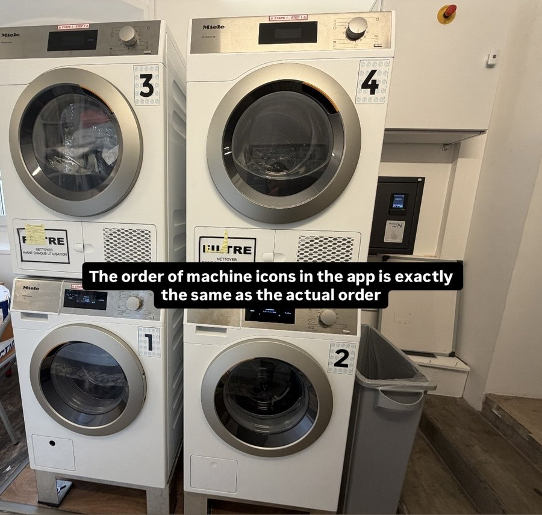
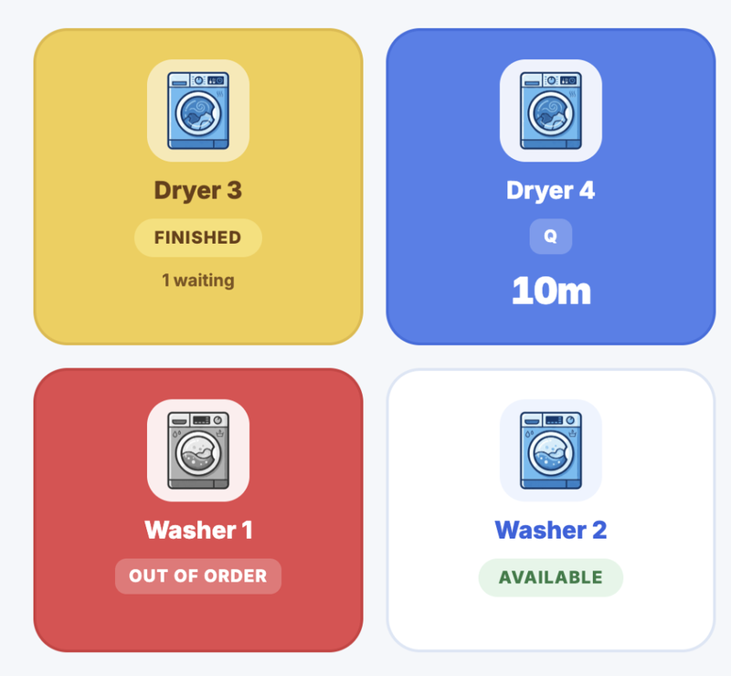
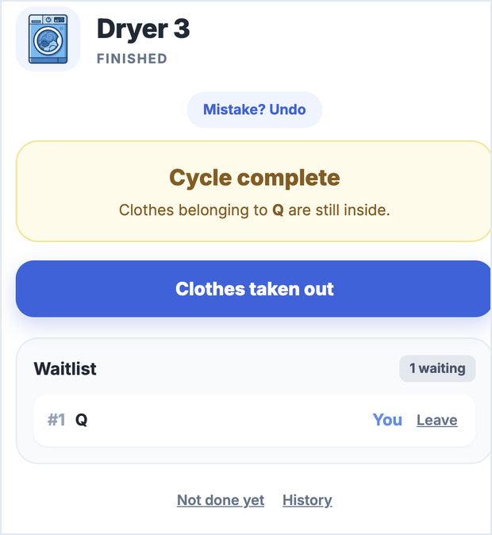
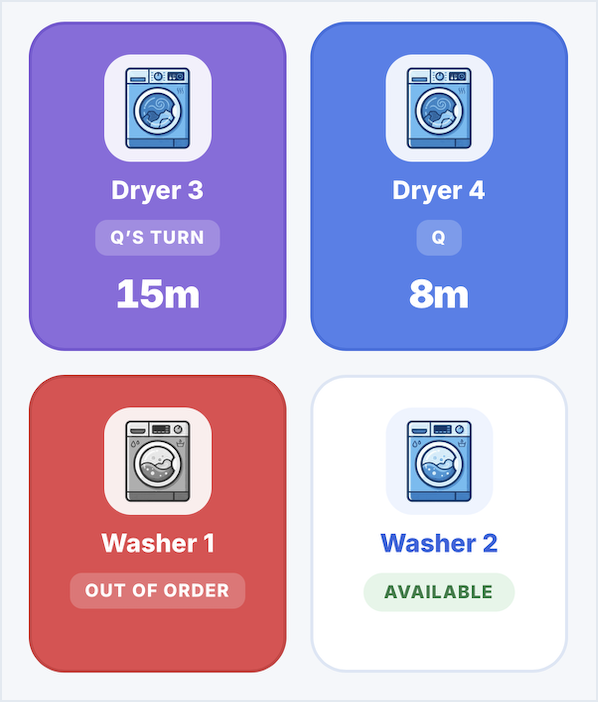
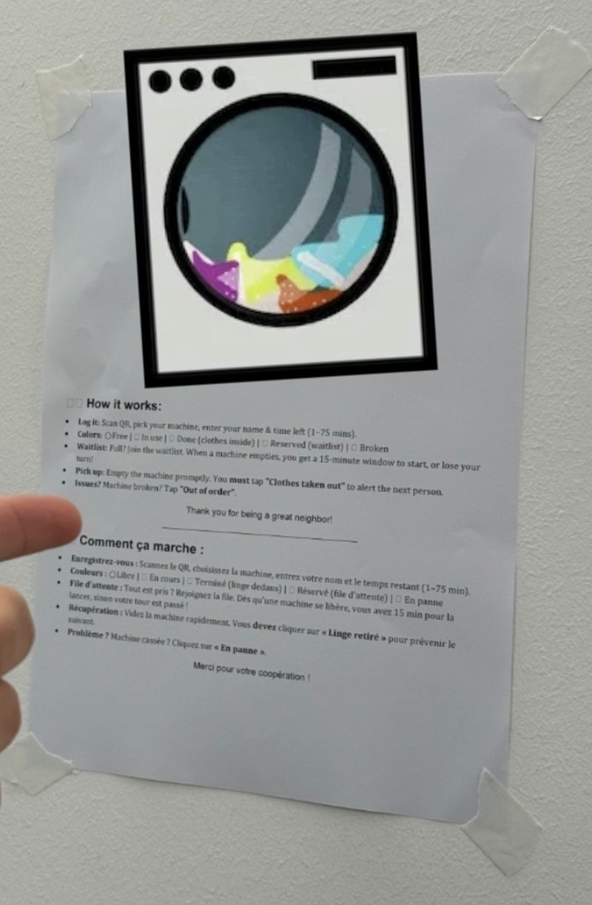
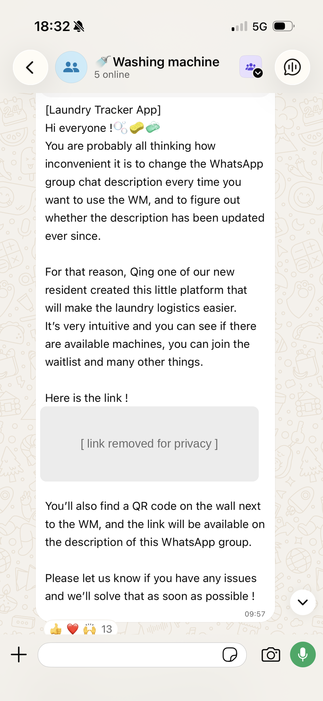

# 🧺 Laundry Tracker

A lightweight, mobile-first web app that shows which washers and dryers are free in a shared student residence, and runs a waitlist when they're all busy.

 &nbsp;&nbsp;

 Above: the real laundry room. Under: the app UI mirroring the actual layout

## 📌 Context & the problem

- **The setting:** about 60 to 70 residents share just 2 washing machines and 2 dryers.
- **The pain point:** weekends are the peak, and everyone wants a machine at the same time. Residents coordinated by editing the WhatsApp group description.
- **Why that failed:**
  - Updating the description was tedious and easy to forget.
  - Opening the group description just to check a machine was slow, so many people never did.
  - The description often didn't match the real machine, so clashes still happened. For example, someone loaded a machine that looked empty but had already been claimed in the description.

## 💡 The solution

Laundry Tracker is a zero-install web app. Residents scan a QR code by the machines, or open the link in the group chat, and see the laundry room at a glance.

- **Layout-mirrored UI.** A 2×2 grid copies the real room: dryers 3 and 4 on top, washers 1 and 2 below, with the same numbers as the machines.
- **Clear machine states.** Available, In use (with a countdown), Finished (clothes still inside), Reserved for the next person in line, or Out of order. The page refreshes every 15 seconds.
- **Waitlist with a 15-minute rule.** When a machine frees up, the first person in line has 15 minutes to start it, or the turn passes to the next person.
- **Edge cases handled:**
  - The 15 minutes only start once the machine has been emptied (someone taps "Clothes taken out"), so a late pick-up never costs the next person their window.
  - You can join a machine's waitlist only once, and starting any machine takes you off every list.
  - You can leave a waitlist if you find another machine or change your plans.
  - Cycles can finish early or run late, so anyone can correct the time left or end a cycle early.
- **English and French bilingual versions offered.**

 &nbsp;&nbsp;

 Above: the cycle has ended, but the machine stays blocked until someone taps "Clothes taken out". Under: once the clothes are out, it is reserved for the first person in line for 15 minutes.

## 📣 Rollout

The residence committee announced it in the residents' WhatsApp group, put a QR code on the wall next to the machines with a bilingual how-to poster, and added the link to the group description. Residents welcomed it, and it is now used as the residents' laundry tracking platform.

 &nbsp;&nbsp;

 The how-to poster and the group-chat announcement (link hidden for privacy).

## 🔄 How it evolved

At first, the product was more like a web form and had a lot of redundant wording, as it was straight from AI vibe coding. Then I asked for advice from a committee member, who had been very supportive and gave me some advice from user's angle.

I designed and added images for machine icons; cleaned up the UI and language; added French version for better usability.

The main obstacle was to consider many possible edge cases in real usage: someone forgot to take out the laundry when it was done; someone's turn for laundry and would need to remove from waiting list of other machines, ....

1. **Committee input.** The committee member suggested the 15-minute waitlist window, and showing the date and time at the top of the page.
2. **One waitlist per machine.** My first version had one list for all washers and one for all dryers. I changed it to one list per machine.
3. **French version added.** The first version was English only. Many residents are native French speakers, so I added a language switch.

## ⚠️ Limitations

- **No notifications.** You have to open the page to see that it's your turn.
- **No login.** Anyone with the link can edit, so there is a 15-minute undo and a short history for each machine.

## 🛠️ Tech & process

- **Frontend:** one HTML file with CSS variables and vanilla JavaScript, built for phones.
- **Backend:** Google Apps Script, with Properties and Cache services as free serverless storage, and a lock so two people can't take the same machine.
- **Built with AI assistance:** I defined the requirements, rules and edge cases, tested it, and rolled it out. Claude (Anthropic) wrote most of the code.

**About this public copy:** the live link and two admin tools are left out for privacy and security.

Run your own copy

1. Create a new project at [script.google.com](https://script.google.com) and paste in `Code.gs`.
2. Add an HTML file named `index` and paste in `index.html`.
3. Edit the `MACHINES` list at the top of `Code.gs` to match your machines.
4. Choose **Deploy, New deployment, Web app**. Set "Execute as" to *Me* and "Who has access" to *Anyone*.

If you add a function to wipe test data, delete it afterwards. Apps Script lets any visitor's browser call functions whose names don't end in an underscore.

## 🚀 Next

- Alerts when your laundry is done and when your waitlist turn arrives.
- Ongoing fixes based on feedback from residents.

[MIT License](LICENSE)
